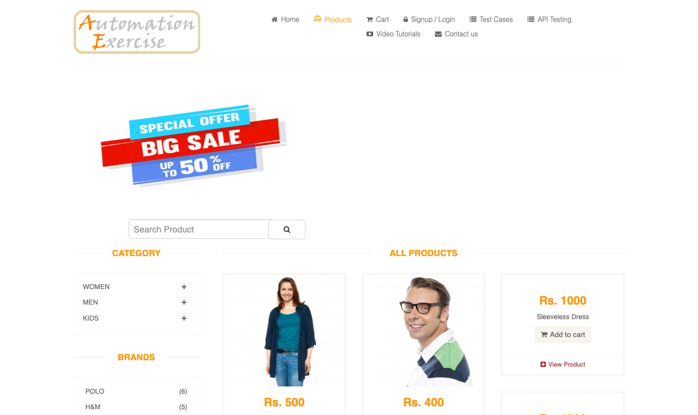
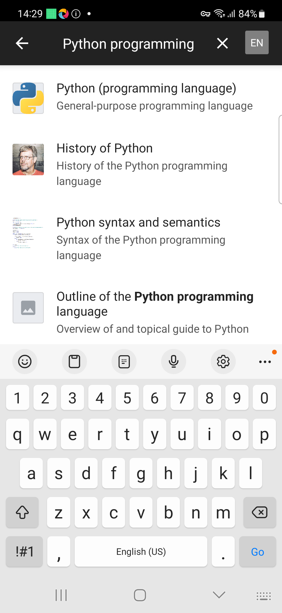
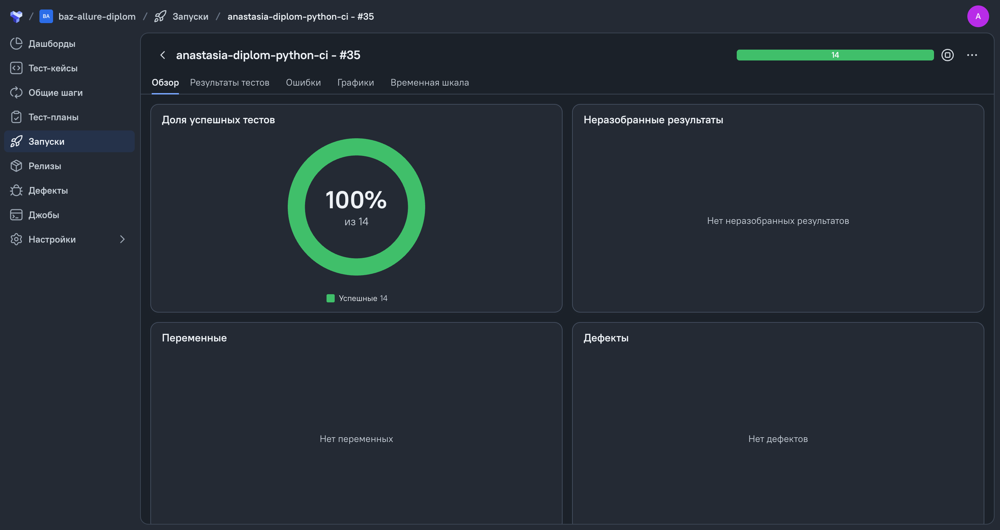
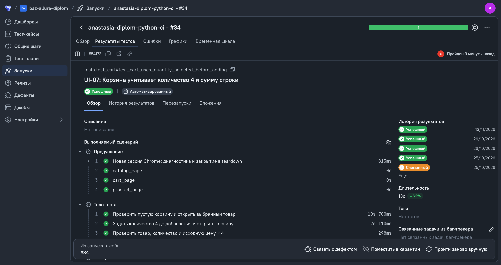
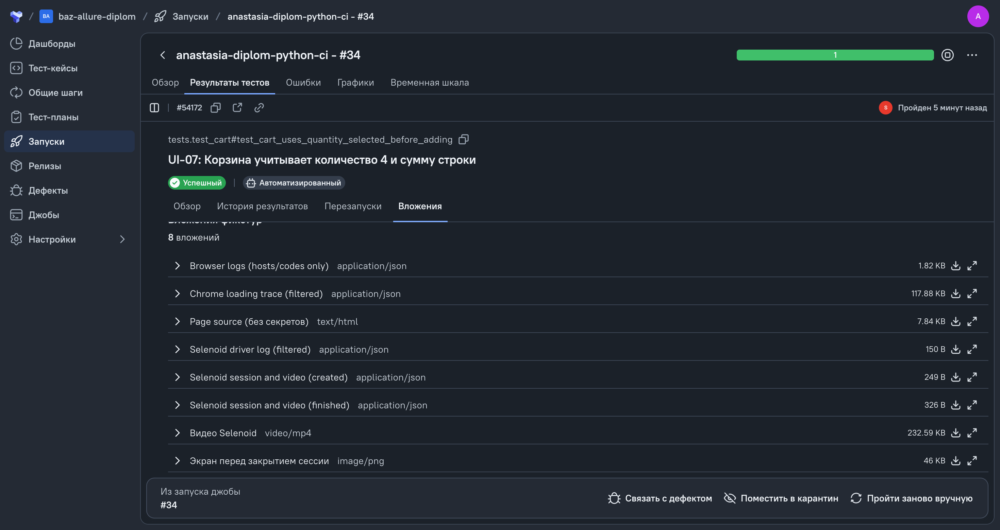
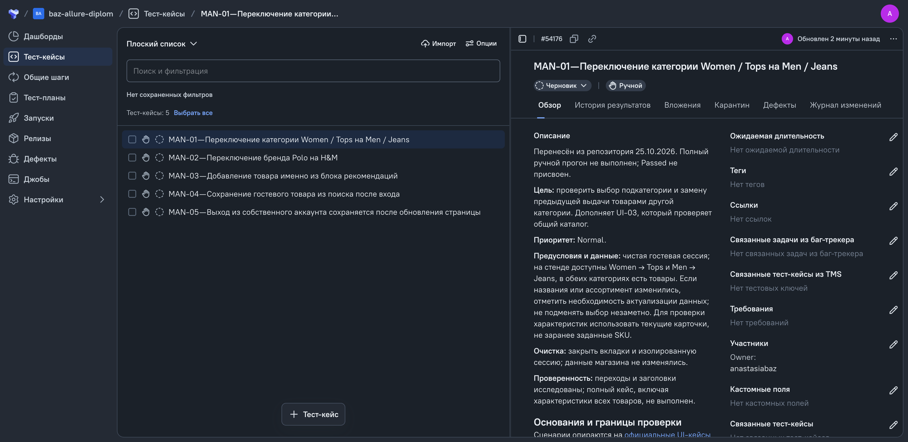

<h1 align="center">Диплом QA.GURU · Python</h1>

Автотесты интернет-магазина **Automation Exercise** и Android-приложения **Wikipedia sample**: 8 UI-, 6 API- и 3 Mobile-сценария. Используются Page Objects, подготовка пользователя через API, модели Pydantic и отчётность Allure.

<p align="center">
   
   
   
   
  
</p>
<p align="center">Python · pytest · Selenium · Selenoid · requests · Pydantic · Appium · BrowserStack · Jenkins · Allure</p>

<p align="center">
  <a href="#products">Продукты</a> · <a href="#coverage">Покрытие</a> ·
  <a href="#run">Запуск</a> · <a href="#reporting">Отчётность</a> · <a href="#status">Статус</a>
</p>

<a id="products"></a>

## Тестируемые продукты

- **[Automation Exercise](https://automationexercise.com/)** — UI и [API](https://automationexercise.com/api_list) учебного интернет-магазина.
- **[Wikipedia Android sample](https://www.browserstack.com/app-automate/sample-apps/android/WikipediaSample.apk)** — учебное приложение версии **2.5.194-alpha-2017-05-30**; Samsung Galaxy S23 / Android 13.0 в BrowserStack.

<a id="coverage"></a>

## Покрытие · 17 сценариев

### UI · 8

- **UI-01** — вход созданным через API пользователем: имя и Logout.
- **UI-02** — неверные реквизиты: ошибка, форма сохранена, авторизации нет.
- **UI-03** — каталог: названия, положительные цены, ссылки на карточки.
- **UI-04** — поиск: исходный товар найден по сохранённым ID и названию; контрольный нерелевантный товар отсутствует.
- **UI-05** — карточка совпадает с данными выбранного товара из каталога.
- **UI-06** — два товара в корзине: состав, цены, количество и суммы строк.
- **UI-07** — количество 4: сумма равна исходной цене × 4.
- **UI-08** — удаление последнего товара: строка исчезает, корзина пуста.

### API · 6

- **API-01** — GET каталога: содержимое и структура товаров.
- **API-02** — POST поиска: товар из свежего каталога найден; контрольный нерелевантный товар отсутствует.
- **API-03** — POST поиска без обязательного поля: сервер возвращает ошибку.
- **API-04** — POST создания аккаунта: исходные реквизиты принимаются.
- **API-05** — DELETE аккаунта: отсутствие по email подтверждено до cleanup, прежние реквизиты больше не принимаются.
- **API-06** — неверный пароль отвергается, исходный продолжает работать.

### Mobile · 3

- **MOBILE-01** — поиск `Python programming` находит `Python (programming language)`.
- **MOBILE-02** — замена запроса показывает `Selenium (software)` и убирает прежний результат.
- **MOBILE-03** — очистка удаляет введённый текст и прежние результаты.

### Ручные кейсы · Allure TestOps

В [TestOps](https://allure.qa.guru/project/5398/test-cases) описаны пять ручных кейсов с условиями, шагами и ожидаемыми результатами. Статус — **«Черновик»**; полный ручной прогон ещё не выполнен.

| Кейс | Проверка |
|---|---|
| [MAN-01 · #54176](https://allure.qa.guru/project/5398/test-cases/54176) | Переключение категории Women / Tops → Men / Jeans |
| [MAN-02 · #54177](https://allure.qa.guru/project/5398/test-cases/54177) | Переключение бренда Polo → H&M |
| [MAN-03 · #54178](https://allure.qa.guru/project/5398/test-cases/54178) | Добавление товара из рекомендаций |
| [MAN-04 · #54179](https://allure.qa.guru/project/5398/test-cases/54179) | Сохранение гостевой корзины после входа |
| [MAN-05 · #54180](https://allure.qa.guru/project/5398/test-cases/54180) | Выход из аккаунта и обновление страницы |

## Как связаны API и UI

Пользователь создаётся через API, затем Page Object выполняет UI-вход. После закрытия браузера аккаунт удаляется, его отсутствие проверяется по email. Pydantic проверяет структуру ответов; цены сравниваются через `Decimal`. [Подробности →](docs/running.md#api-checks)

<a id="run"></a>

## Установка и запуск

Установка проверена на **Python 3.13.7**. Требуется Python **3.13+**, для локального UI — Chrome. Команды выполняются из корня проекта в bash или zsh:

```bash
python3 -m venv .venv
mkdir -p .tmp
.venv/bin/python -m pip install -r requirements.txt
.venv/bin/python -m pip check
```

[Зависимости для разработки и проверки качества →](docs/running.md#quality)

**UI — локальный Chrome, 8 тестов:**

```bash
RUN_DIR=".artifacts/runs/ui-$(date -u +%Y%m%dT%H%M%S)"
.venv/bin/python -m pytest \
  tests/test_login.py tests/test_catalog.py tests/test_product.py tests/test_cart.py \
  --ui-mode=local -v --alluredir="$RUN_DIR/allure-results"
```

**API — без браузера, 6 тестов:**

```bash
RUN_DIR=".artifacts/runs/api-$(date -u +%Y%m%dT%H%M%S)"
.venv/bin/python -m pytest tests/api -v --alluredir="$RUN_DIR/allure-results"
```

**Mobile — BrowserStack App Automate, 3 теста последовательно:**

```bash
RUN_DIR=".artifacts/runs/mobile-$(date -u +%Y%m%dT%H%M%S)"
.venv/bin/python -m pytest mobile -v --maxfail=1 --alluredir="$RUN_DIR/allure-results"
```

API и локальный UI работают без `.env`. Для Selenoid и BrowserStack заполните корневой `.env` по образцу [.env.example](.env.example). Для Mobile нужен APK, заранее загруженный в App Automate. [Настройка BrowserStack →](docs/running.md#mobile-browserstack)

[Настройка Jenkins и Selenoid, команды Allure →](docs/running.md)

<a id="reporting"></a>

## Отчётность

Allure содержит группы UI/API/Mobile, шаги, скриншоты, исходный код страниц, логи и API-обмены. Секретные поля маскируются. Видео прикрепляется при доступности.

<details>
<summary><b>Automation Exercise и Wikipedia · 22.10.2026</b></summary>

<p>
  <a href="docs/images/ui_catalog.png"></a>
  <a href="docs/images/mobile_search.png"></a>
</p>

[Происхождение изображений](docs/images/README.md)

</details>

**[Пример Mobile-видео · 22.10.2026 →](https://app-automate.browserstack.com/builds/08f506e141fa67697527228d24e16182ed0f5b34/sessions/0a0ce7880f0af9ea4a62b2705b7fd4a47c320612)** Поиск Python в Wikipedia.

### Jenkins, Allure Report и TestOps

[Сборка Jenkins №35](https://jenkins.qa.guru/job/anastasia-diplom-python-ci/35/) от **18.11.2026** завершилась успешно: **14 passed — 8 UI и 6 API** на коммите [`80d2f86`](https://github.com/abzva/diplom_qa_python/commit/80d2f866bad5a10f4c3f6ffcc33f5640ced8fa51). UI выполнялись через Selenoid; Mobile в этот запуск не входил.

[Allure Report №35](https://jenkins.qa.guru/job/anastasia-diplom-python-ci/35/allure/) · [TestOps #57388](https://allure.qa.guru/launch/57388)

Срок хранения подробностей успешных тестов в учебном TestOps — 24 часа; очистка применяется к закрытым запускам. [Хранение отчётов →](docs/running.md#allure-report-и-testops)

Обзор [запуска #57388](https://allure.qa.guru/launch/57388), сборка №35, от **18.11.2026**:

[](https://allure.qa.guru/launch/57388)

<details>
<summary><b>Шаги UI-теста, вложения и ручные кейсы</b></summary>

**Пример из сборки №34 от 18.11.2026: UI-07 — количество 4 и сумма строки корзины.**

[](https://allure.qa.guru/launch/57387/tree/1199086)

**Вложения UI-07:** лог, HTML, скриншот, видео и диагностика браузера.

[](https://allure.qa.guru/launch/57387/tree/1199086/attachments)

**Ручные кейсы — сохранённый пример от 25.10.2026:**

[](https://allure.qa.guru/project/5398/test-cases)

[Происхождение скриншотов](docs/images/README.md)

</details>

<a id="status"></a>

## Результаты и ограничения

Все 14 UI/API-сценариев подтверждены сборкой №35 на `80d2f86`. Три Mobile-сценария запускаются отдельно; результат №35 на них не распространяется.

- Mobile поддерживает только BrowserStack App Automate; нужны доступ к сервису и загруженный APK.
- В Mobile-прогоне от 13.11.2026 видео не удалось прикрепить; скриншоты и исходный код страниц сохранены. Доступна [загрузка позднего видео](docs/running.md#позднее-видео-browserstack).
- Доступность внешних учебных стендов влияет на результаты тестов.

Для просмотра Jenkins, TestOps и BrowserStack может требоваться авторизация.
