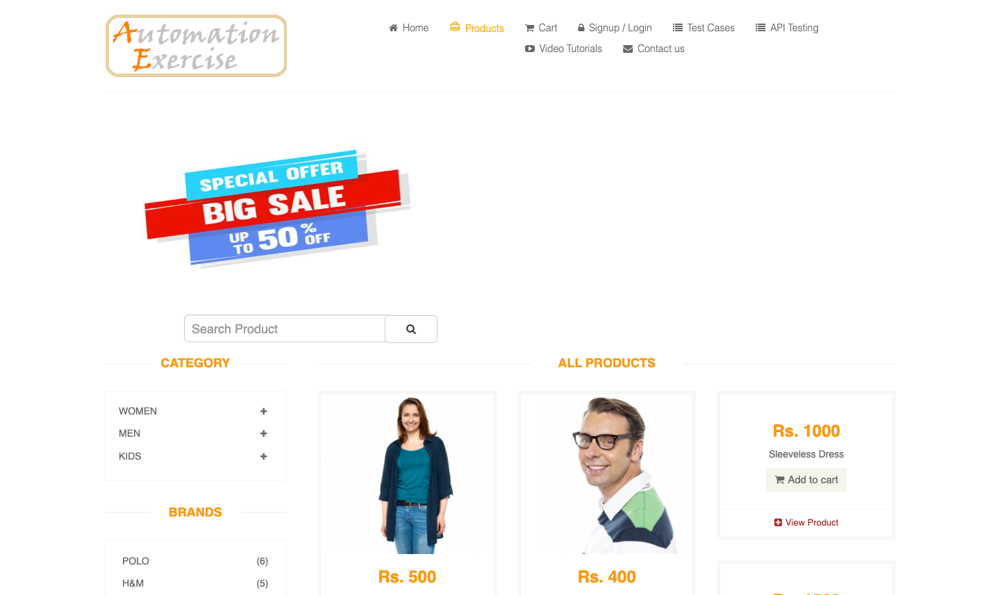
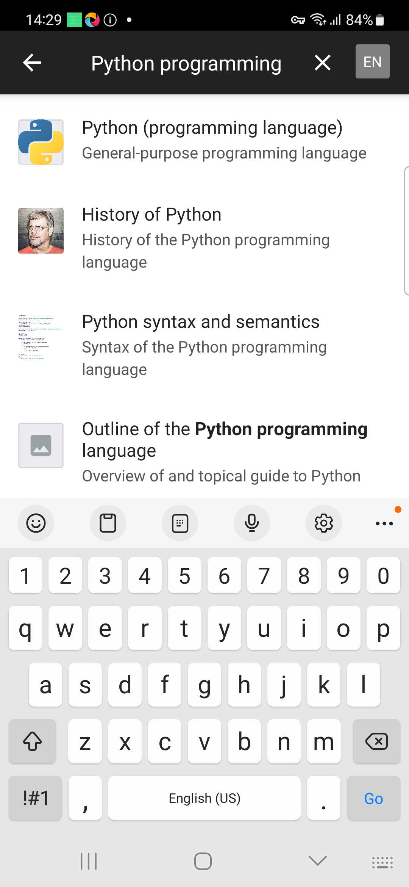
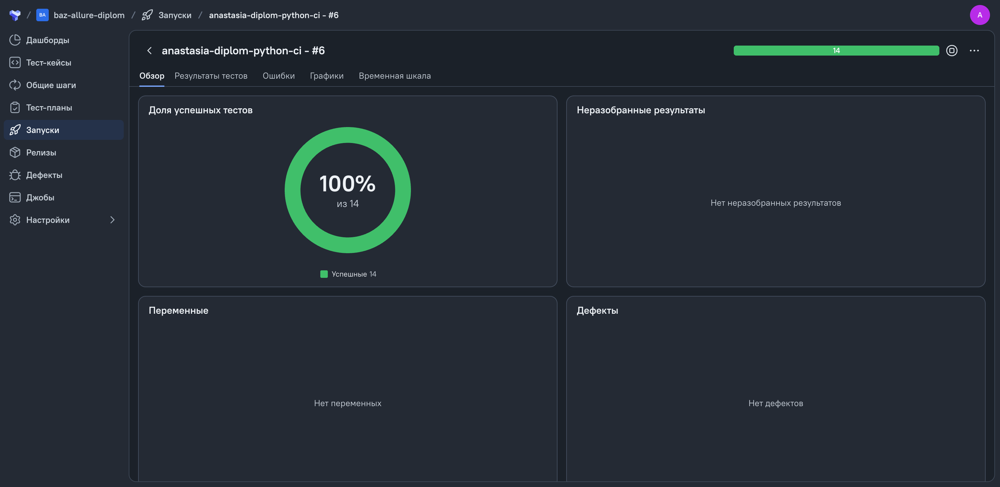
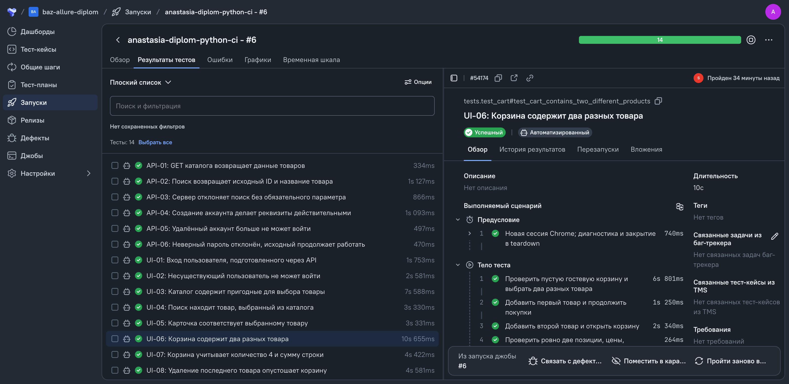
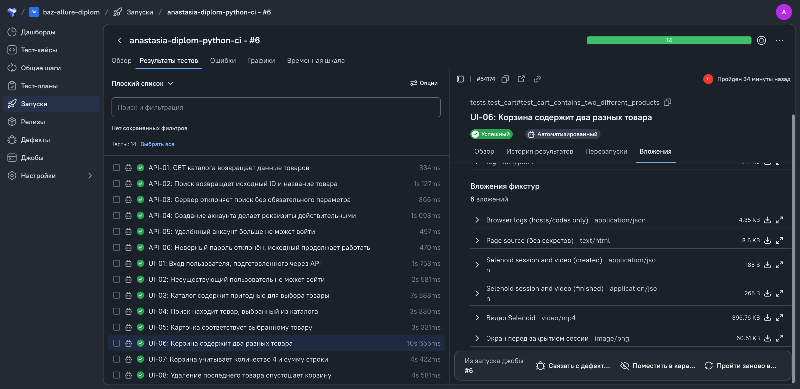
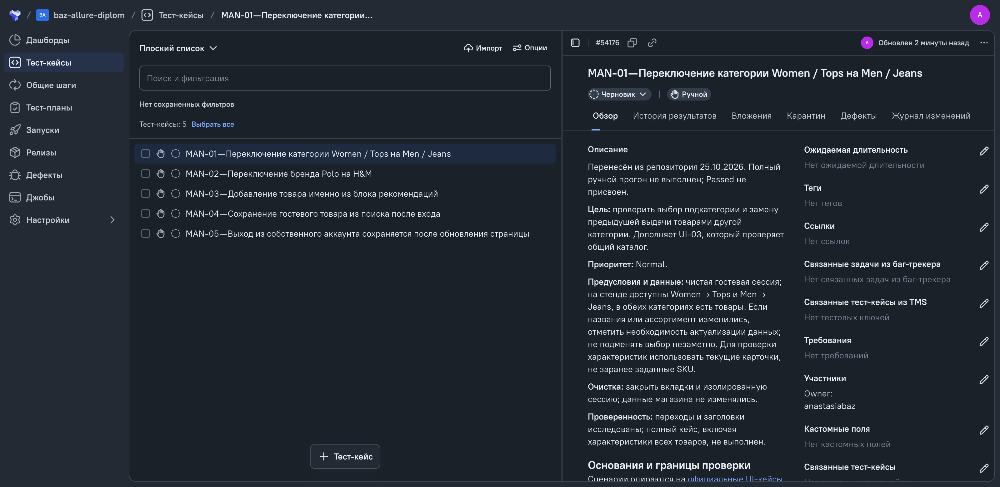

<h1 align="center">Диплом QA.GURU · Python</h1>

Автотесты интернет-магазина **Automation Exercise** и Android-приложения **Wikipedia sample**: 8 UI-, 6 API- и 3 Mobile-сценария. Используются Page Objects, подготовка пользователя через API, модели Pydantic и отчётность Allure.

**UI/API в Jenkins: 14 passed за 62,02 с.** Восемь UI-тестов выполнены через Selenoid; три Mobile-теста ранее проходили отдельно через BrowserStack.

<p align="center">
   
   
   
   
  
</p>
<p align="center">Python · pytest · Selenium · requests · Pydantic · Appium · BrowserStack · Allure</p>

<p align="center">
  <a href="#products">Продукты</a> · <a href="#coverage">Покрытие</a> ·
  <a href="#run">Запуск</a> · <a href="#reporting">Отчётность</a> · <a href="#status">Статус</a>
</p>

<a id="products"></a>

## Тестируемые продукты

- **[Automation Exercise](https://automationexercise.com/)** — UI магазина и [API](https://automationexercise.com/api_list): вход, каталог, поиск, карточка, корзина, жизненный цикл своего аккаунта. Без покупок и оплаты.
- **[Wikipedia Android sample](https://www.browserstack.com/app-automate/sample-apps/android/WikipediaSample.apk)** — поиск, замена и очистка запроса через BrowserStack. Версия **2.5.194-alpha-2017-05-30**, Samsung Galaxy S23 / Android 13.0. Это старый учебный sample, не актуальная Wikipedia.

<a id="coverage"></a>

## Покрытие · 17 сценариев

### UI · 8

- **UI-01** — вход созданным через API пользователем: имя и Logout.
- **UI-02** — неверные реквизиты: ошибка, форма сохранена, авторизации нет.
- **UI-03** — каталог: названия, положительные цены, ссылки на карточки.
- **UI-04** — поиск: исходный товар найден по сохранённым ID и названию.
- **UI-05** — карточка совпадает с данными выбранного товара из каталога.
- **UI-06** — два товара в корзине: состав, цены, количество и суммы строк.
- **UI-07** — количество 4: сумма равна исходной цене × 4.
- **UI-08** — удаление последнего товара: строка исчезает, корзина пуста.

### API · 6

- **API-01** — GET каталога: содержимое и структура товаров.
- **API-02** — POST поиска: товар из свежего каталога найден.
- **API-03** — POST поиска без обязательного поля: сервер возвращает ошибку.
- **API-04** — POST создания аккаунта: исходные реквизиты принимаются.
- **API-05** — DELETE аккаунта: прежние реквизиты больше не принимаются.
- **API-06** — неверный пароль отвергается, исходный продолжает работать.

### Mobile · 3

- **MOBILE-01** — поиск `Python programming` находит `Python (programming language)`.
- **MOBILE-02** — замена запроса показывает `Selenium (software)` и убирает прежний результат.
- **MOBILE-03** — очистка удаляет введённый текст и прежние результаты.

### Ручные кейсы · Allure TestOps

Пять ручных кейсов перенесены в [проект TestOps](https://allure.qa.guru/project/5398/test-cases): условия, данные, приоритеты, 23 шага с отдельными ожидаемыми результатами и очистка. Кейсы имеют статус **«Черновик»**; полный ручной прогон ещё не выполнен.

| Кейс | Проверка |
|---|---|
| [MAN-01 · #54176](https://allure.qa.guru/project/5398/test-cases/54176) | Переключение категории Women / Tops → Men / Jeans |
| [MAN-02 · #54177](https://allure.qa.guru/project/5398/test-cases/54177) | Переключение бренда Polo → H&M |
| [MAN-03 · #54178](https://allure.qa.guru/project/5398/test-cases/54178) | Добавление товара из рекомендаций |
| [MAN-04 · #54179](https://allure.qa.guru/project/5398/test-cases/54179) | Сохранение гостевой корзины после входа |
| [MAN-05 · #54180](https://allure.qa.guru/project/5398/test-cases/54180) | Выход из аккаунта и обновление страницы |

## Как связаны API и UI

Фикстура создаёт уникального пользователя через API; Page Object выполняет UI-вход и проверяет имя. Очистка удаляет только созданный тестом аккаунт и подтверждает его отсутствие, в том числе после падения теста.

Pydantic-модели формируют запросы и проверяют ответы. HTTP-статус и бизнес-код проверяются отдельно; цены сравниваются через `Decimal`. Каждый тест использует отдельную сессию браузера или HTTP-клиента.

<a id="run"></a>

## Установка и запуск

В Jenkins использован **Python 3.14.4**, локальное окружение — **3.13.7**. Для локального UI нужен Chrome. Команды выполняются из корня проекта; создавайте `.venv` только если её ещё нет:

```bash
python3 --version
python3 -m venv .venv
mkdir -p .tmp/pip .cache/pip
TMPDIR="$PWD/.tmp/pip" .venv/bin/python -m pip install \
  --cache-dir .cache/pip -r requirements.txt
.venv/bin/python -m pip check
```

**UI — локальный Chrome, 8 тестов:**

```bash
RUN_DIR=".artifacts/runs/ui-$(date -u +%Y%m%dT%H%M%S)"
.venv/bin/python -m pytest \
  tests/test_login.py tests/test_catalog.py tests/test_product.py tests/test_cart.py \
  --ui-mode=local -v --alluredir="$RUN_DIR/allure-results"
```

**API — без браузера, 6 тестов:**

```bash
RUN_DIR=".artifacts/runs/api-$(date -u +%Y%m%dT%H%M%S)"
.venv/bin/python -m pytest tests/api -v --alluredir="$RUN_DIR/allure-results"
```

**Mobile — только BrowserStack, 3 теста:**

```bash
RUN_DIR=".artifacts/runs/mobile-$(date -u +%Y%m%dT%H%M%S)"
.venv/bin/python -m pytest mobile -v --alluredir="$RUN_DIR/allure-results"
```

API и локальный UI работают без облачных реквизитов. Для Selenoid и BrowserStack нужны соответствующие поля из [.env.example](.env.example) в корневом `.env`. Mobile использует заранее загруженное приложение в App Automate; локальный Android/Appium-режим не реализован.

[Подробная настройка, общий запуск 14 тестов, Selenoid и команды Allure →](docs/running.md)

<a id="reporting"></a>

## Отчётность и реальные материалы

Allure: группы UI/API/Mobile, названия, шаги и безопасные вложения. **UI:** PNG, HTML и логи; **API:** запрос/ответ и транспортные ошибки; **Mobile:** PNG, page source, ссылка на сессию и видео. Секретные поля маскируются; диагностика собирается до закрытия сессии.

<details>
<summary><b>Automation Exercise и Wikipedia · 22.10.2026</b></summary>

<p>Каталог Automation Exercise и поиск Wikipedia. Нажмите для просмотра оригинала.</p>
<p>
  <a href="docs/images/ui_catalog.png"></a>
  <a href="docs/images/mobile_search.png"></a>
</p>

[Происхождение изображений](docs/images/README.md)

</details>

**[Mobile-сессия и видео →](https://app-automate.browserstack.com/builds/08f506e141fa67697527228d24e16182ed0f5b34/sessions/0a0ce7880f0af9ea4a62b2705b7fd4a47c320612)** Поиск Python в Wikipedia. MP4 получен после завершения сессии и добавлен в копию результатов Allure. Для просмотра может требоваться авторизация в BrowserStack.

### Jenkins и Allure TestOps

[anastasia-diplom-python-ci](https://jenkins.qa.guru/job/anastasia-diplom-python-ci/) — задача **Freestyle**. Подтверждённый прогон коммита [4b051a9](https://github.com/abzva/diplom_qa_python/commit/4b051a9c88969be54811b81ac889333b472762bc): **14 passed за 62,02 с**, Python 3.14.4, Chrome 156.0.8078.47. Очистка четырёх аккаунтов подтверждена; ошибок teardown нет.

Результаты загружены в [TestOps, jobrun #56202](https://allure.qa.guru/jobrun/56202) без ошибок. Ниже — скриншоты [запуска #56722](https://allure.qa.guru/launch/56722), сделанные 25.10.2026. Для просмотра сервиса может потребоваться авторизация. **Публикация отдельного Allure Report в Jenkins пока не подтверждена.**

[](https://allure.qa.guru/launch/56722)

<details>
<summary><b>Шаги UI-теста, вложения и ручные кейсы</b></summary>

**UI-06 — проверка двух разных товаров в корзине:**

[](https://allure.qa.guru/launch/56722/tree/1153434)

**Вложения UI-06:** логи, HTML страницы, сведения о Selenoid, PNG и MP4 «Видео Selenoid» (396,76 КБ). [Открыть вложения и видео →](https://allure.qa.guru/launch/56722/tree/1153434/attachments)

[](https://allure.qa.guru/launch/56722/tree/1153434/attachments)

**Пять перенесённых ручных кейсов:**

[](https://allure.qa.guru/project/5398/test-cases)

[Происхождение скриншотов](docs/images/README.md)

</details>

<a id="status"></a>

## Что осталось перед сдачей

- Запустить Mobile в Jenkins: пока подтверждён отдельный запуск трёх тестов через BrowserStack. Общего прогона всех 17 тестов не было.
- Опубликовать Allure Report в Jenkins и добавить рабочую ссылку. TestOps не заменяет этот отчёт.
- Выполнить пять ручных кейсов в TestOps и записать фактические результаты.
- Завершить профиль GitHub со ссылками на дипломный проект.
- Закрыть расхождение с [Mobile-требованиями QA.GURU](https://github.com/qa-guru/diploma-requirements/wiki/MOBILE-тестирование-Python): реализован только BrowserStack, локального режима нет. Согласование этого отклонения с преподавателем не подтверждено.
- Проверить полное воспроизведение UI-видео и наличие вложений у всех восьми UI-тестов. MP4 «Видео Selenoid» подтверждён в предыдущем одиночном успешном запуске.

[Инструкции](docs/running.md) · [Результаты и сверка с требованиями](docs/validation.md)
